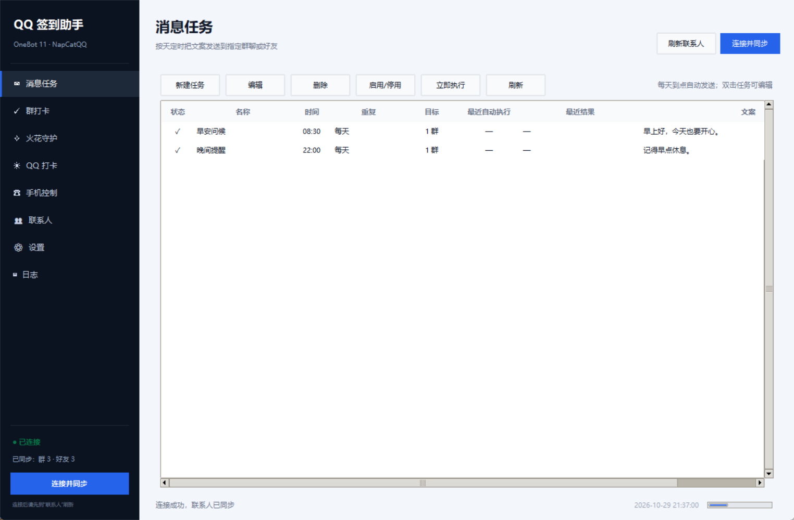
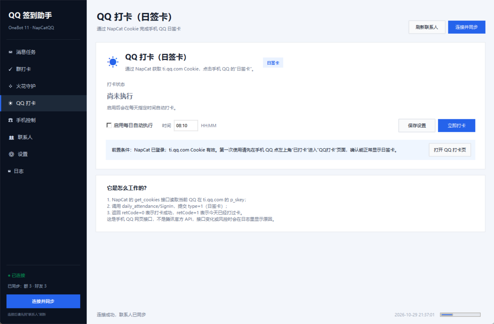
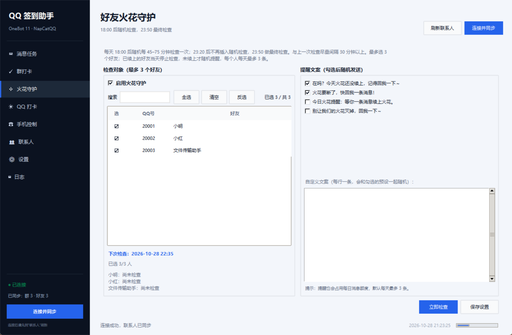
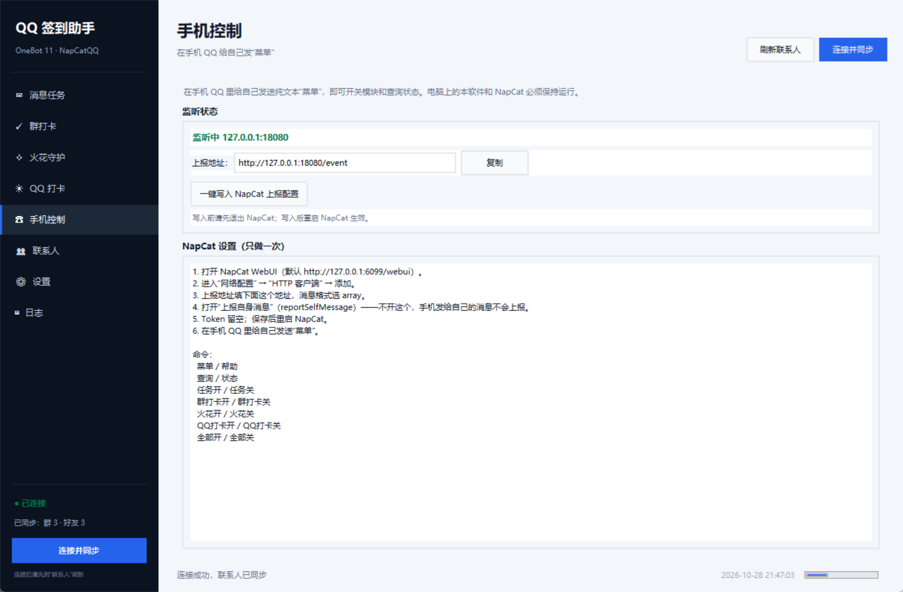
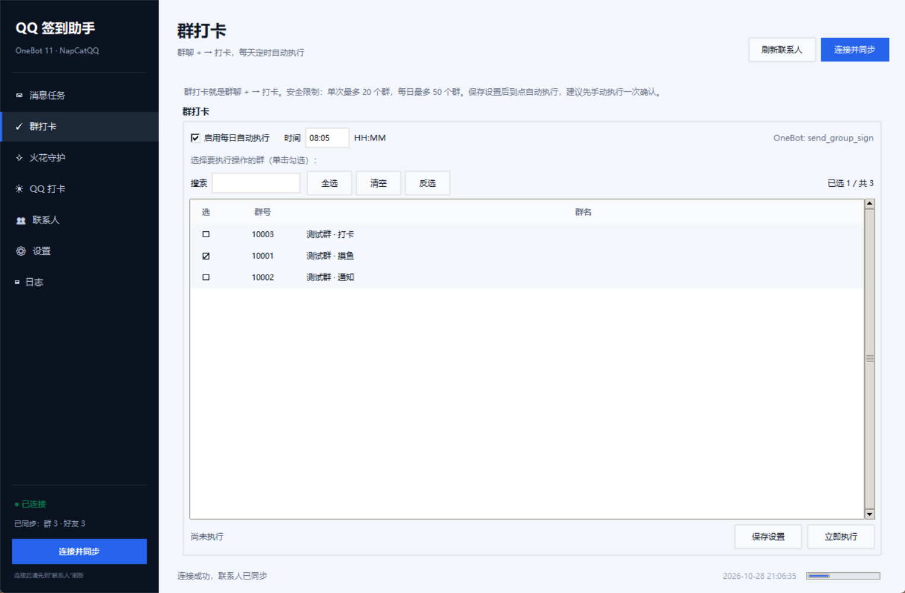
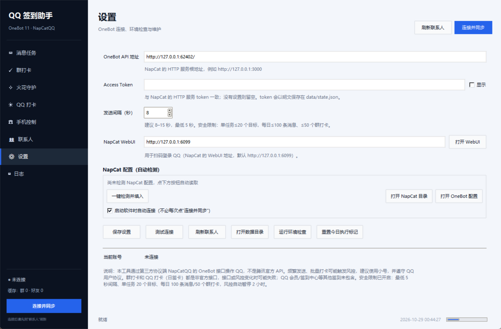

# QQ 签到助手

一个本地 Windows 桌面工具，用来管理 QQ 群消息、群打卡、QQ 打卡（日签卡）、好友火花守护和手机 QQ 控制。

技术栈刻意保持简单：

- Python 3.10+ 标准库，Tkinter 界面，**不需要 pip 安装任何依赖**；
- 通过 [NapCatQQ](https://github.com/NapNeko/NapCatQQ) 提供的 **OneBot 11 HTTP API** 操作 QQ；
- 个人打卡通过 NapCat 的 `get_cookies` 获取 QQ 打卡 Cookie，再调用 QQ 打卡网页接口；
- 状态保存在本地 JSON，日志按 2MB 滚动。

> **重要说明**
>
> 1. 这不是腾讯官方 API。第三方协议端存在账号风控/封号风险，建议使用小号，并遵守 QQ 用户协议。
> 2. 本版本只保留“群打卡”（`send_group_sign`）。
> 3. “个人打卡”指 **手机 QQ 的 QQ 打卡（日签卡）**（左上角“已打卡”进入的页面），不是 QQ 会员/签到中心的签到。它依赖手机 QQ 网页接口，接口变化时可能失效。
> 4. 登录 QQ 由 NapCatQQ 完成；本软件负责连接 NapCat、同步联系人、发送消息、执行群打卡和个人打卡。

## 账号保护措施

**不能保证账号绝对不被封。** NapCat 是第三方协议端，使用它本身就有风险。
本软件能做的是降低“高频操作”带来的额外风险：

- 发送间隔最低 5 秒，默认 8 秒；界面设置低于 5 秒会被强制上调；
- 单个消息任务最多 20 个目标；
- 每天最多发送 100 条消息；
- 单次最多群打卡 20 个群；
- 每天最多群打卡 50 个群；
- 检测到“风控 / 操作频繁 / 账号异常 / 登录失效”等错误时，自动暂停后续操作 2 小时；
- 每日计数和暂停状态保存在 `data/state.json`，重启软件不会清零；
- 到点任务不会无限重试。

建议：

- 用小号，不要用主号；
- 不要设置 1 秒内批量发送；
- 不要一天给几百个群发消息；
- 不要在账号刚登录、刚改密码、刚异地登录时立刻跑大量任务；
- 不要群发广告或重复内容。

如果出现风控提示，立即停止自动任务，等一段时间再手动测试。

## 界面

消息任务：



QQ 打卡（日签卡）：



好友火花守护：



手机控制：



群打卡：



## 前置条件

| 项目 | 要求 | 怎么确认 |
|---|---|---|
| 系统 | Windows 10/11 | `winver` |
| Python | 3.10+，带 Tkinter | `python --version`、`python -c "import tkinter; print(tkinter.TkVersion)"` |
| QQ | 建议小号，能正常登录 | 手机 QQ 扫码 |
| NapCatQQ | 能启动并登录，开启 OneBot 11 HTTP | NapCat WebUI 显示在线 |
| OneBot HTTP | 地址、端口、token 与软件一致 | 浏览器/`check_env.py` 检查 |
| 网络 | 能访问 `ti.qq.com` | 手机 QQ 左上角“已打卡” → “QQ打卡”能打开 |

不需要安装数据库、Node.js 或 pip 包。`run.bat` 会直接调用 Python 标准库。

## 第一次运行

### 1. 检查 Python

在项目文件夹地址栏输入 `cmd` 回车，或打开 PowerShell：

```powershell
cd /d "D:\qq签到"
python --version
python -c "import tkinter; print(tkinter.TkVersion)"
```

两条命令都能输出内容才继续。第二条报 `No module named tkinter` 时，重新安装 [python.org 的 Windows 版 Python](https://www.python.org/downloads/windows/)，安装时勾选 **tcl/tk and IDLE**。

### 2. 启动 NapCat 并登录 QQ

详细步骤见 [NapCat 安装与 OneBot 配置](docs/NAPCAT_SETUP.md)。

1. 按 [NapCatQQ 文档](https://doc.napneko.icu/) 安装并启动 NapCat；
2. 打开 NapCat WebUI，用 QQ 扫码登录（建议小号）；
3. 在 NapCat 的“网络配置”里启用 **OneBot 11 HTTP 服务**：
   - 监听地址：`127.0.0.1`
   - 端口：例如 `3000`
   - Token：可留空；如果设置了，记下来填到本软件；
4. 不要把该端口暴露到公网。

### 3. 启动软件

直接双击项目根目录的 `run.bat`。

或者手动：

```powershell
cd /d "D:\qq签到"
python -m qq_signin
```

如果 `run.bat` 一闪而过，先在该目录打开 PowerShell 执行 `python -m qq_signin`，看具体报错。

### 4. 连接

1. 左侧“设置”；
2. 点 **“一键检测并填入”**：软件会扫描常见 NapCat 安装位置，自动读取 `config/onebot11_*.json` 里的 OneBot 地址和 Token；
3. 如果没检测到，再手动填写 OneBot API 地址，例如 `http://127.0.0.1:3000`；
4. 确认勾选 **“启动软件时自动连接”**；
5. 点“保存设置”；
6. 首次使用点“测试连接”，成功后再点右上角“连接并同步”；
7. 到“联系人”页确认群聊和好友已经出现。

设置页还可以直接：

- **打开 WebUI**：扫码登录 NapCat；
- **打开 NapCat 目录**；
- **打开 OneBot 配置**；
- **运行环境检查**。



> 之后每次启动软件会自动连接，不需要再点“连接并同步”。  
> 如果 NapCat 重启过，点右上角“连接并同步”即可恢复。

### 5. 先做一次手动测试

- 新建一条只发给自己的任务，点“立即执行”，确认收到；
- 群打卡选一个群，点“立即执行”，看日志是否成功；
- QQ 打卡页点“立即打卡”，看返回是“打卡成功”还是“今天已经打卡过了”。

确认手动执行没问题，再启用每日定时。

## 怎么检查能不能运作

### 方法一：命令行环境检查（推荐）

最简单：双击项目根目录的 `check_env.bat`，按提示看结果。

仅检查本机：

```powershell
python tools/check_env.py
```

检查本机 + OneBot + QQ 打卡 Cookie：

```powershell
python tools/check_env.py --url http://127.0.0.1:3000
```

有 token：

```powershell
python tools/check_env.py --url http://127.0.0.1:3000 --token 你的token
```

输出含义：

- `[✓]` 通过；
- `[!]` 警告/跳过（例如没有配置 URL，或 QQ 打卡 Cookie 缺少 `p_skey`）；
- `[✗]` 失败，需要按后面的提示修复。

检查项包括：Python 版本、Tkinter、数据目录写权限、OneBot 登录、群列表、好友列表、QQ 打卡 Cookie。

### 方法二：软件内检查

- “设置” → “测试连接”：只验证 OneBot 登录；
- “设置” → “运行环境检查”：检查本机 Python/Tkinter/数据目录；
- “设置” → “刷新联系人”：验证群/好友接口；
- “日志”页：查看每一步调用和错误原因。

### 成功的样子

- 左上角显示“● 已连接”，左侧底部显示“已同步：群 x · 好友 y”；
- “联系人”页有数据；
- “日志”里能看到 `连接成功`、`已发送`、`打卡成功` 等；
- 个人打卡返回 `retCode=0` 或 `retCode=1`（今天已打卡）。

## 功能使用

### 定时消息

1. “联系人”页勾选目标（单击行勾选），点“用选中项新建任务”；或直接在“消息任务”页点“新建任务”；
2. 填写名称、执行时间、重复方式、文案；
3. “每天”会在每天该分钟发送；“仅一次”需要填日期 `YYYY-MM-DD`；
4. 保存后任务默认启用；
5. “立即执行”用于测试。**手动执行不会写入“最近自动执行”日期**，当天定时计划仍会执行；
6. 双击任务编辑，选中后可启用/停用/删除。

### 发送 QQ 表情

QQ 的内置小黄脸不是普通文字，复制到剪贴板通常会变成 `n`、`ń`、方块或其他占位字符。
普通小黄脸用 `face` 标记，例如：

```text
[face:12]
```

新建/编辑任务时，在“发送文案”上方：

1. 选择 `调皮 (12)`（普通吐舌小黄脸）；
2. 点“插入”；
3. 文本框里会出现类似 `[face:12]` 的标记；
4. 可以继续输入文字，例如：

```text
早上好[face:12]
```

发送时软件会自动转换成 OneBot 的 `face` 消息段，不会发送字母 `n`/`ń`。

**关于“吃糖”**：QQ 的 `吃糖` 是超级表情（`emojiId=324, emojiType=1`），
用 `[face:324]` 发送会显示成大版，这是 QQ 的映射，不是软件写错。
如果要小版外观，请选择 `吃糖（超级） (324)` 后点 **“插入小版图片”**；
软件会从本机 QQ 安装目录取静态小图，按图片发送（显示为图片，不是超级表情动画）。

> 普通小黄脸（`face` ID 小于 260）会显示为小版；  
> 超级表情/商城表情不能通过 `face` 变成普通表情。

### 群打卡

群打卡就是群聊输入框旁边 `+` → “打卡”里的功能。

| 功能 | 群里的入口 | OneBot 接口 |
|---|---|---|
| 群打卡 | 群聊 `+` → 打卡 | `send_group_sign` |

操作：

1. 打开“群打卡”页；
2. 搜索并勾选你的群，例如“非学会”；
3. 设置时间，勾选“启用每日自动执行”；
4. 点“保存设置”；
5. 先点“立即执行”，确认 QQ 群里出现“今日已成功打卡”。

如果群本身没有打卡功能，NapCat 会返回错误，日志里有具体原因。

### QQ 打卡（日签卡）

这就是手机 QQ 左上角“已打卡”进入的“QQ打卡”页面里的日签卡。

实现路径：

1. NapCat `get_cookies` 获取 `ti.qq.com` 的 Cookie；
2. 取 `p_skey` 和 `uin`；
3. 向 `daily_attendance/SignIn` 提交 `type=1` 的日签卡请求；
4. `retCode=0` 成功，`retCode=1` 今天已打卡。

操作：

1. 左侧“QQ 打卡”；
2. 勾选“启用每日自动执行”，设置时间；
3. 点“保存设置”；
4. 先点“立即打卡”测试；
5. 如果提示 Cookie 无效，先在手机 QQ 左上角“已打卡”里打开一次“QQ打卡”页面，再回软件重试。

注意：

- 需要 NapCat 登录的账号和手机 QQ 是同一个账号；
- 个人打卡依赖手机 QQ 网页接口，不是官方开放 API；
- 只实现了手机 QQ 的 QQ 打卡（日签卡），QQ 会员/签到中心等其他签到未包含。

### 好友火花守护

用途：每天 18:00 后随机检查最多三个好友有没有发消息续火花；
没续上的人发送一条提醒文案；已经续上的人当天停止检查。

规则：

- 最多选择 3 个好友，分别检查、分别提醒；
- 18:00 后第一次检查在 18:45–19:15；
- 之后每 45–75 分钟随机检查一次；
- 23:20 后不再插入随机检查，23:50 做最终检查；
- 与上一次检查尽量间隔 30 分钟以上；
- 每个好友每天最多发送 3 条提醒；
- 提醒也占用每日消息额度。

实现方式：分别读取与每个好友的私聊历史，只看时间、发送者，不读取正文。
如果某个好友今天发过消息，就认为他的火花已续上；否则从勾选的文案里随机选一条发给他。

注意：

- “火花”是 QQ 客户端的功能，本软件只能根据“对方今天是否发过私聊消息”推断，
  不保证与 QQ 客户端显示的火焰状态 100% 一致；
- 如果对方昨天/更早发过消息，但今天没发，仍会提醒；
- 如果你今天还没发消息，火花也可能不会续上；软件只检查对方是否发消息。

### 手机 QQ 控制

在手机 QQ 里给自己发送纯文本命令，可以开关模块和查询状态。
本软件只监听本机 `127.0.0.1:18080`，不开放公网；只接受自己发给自己的私聊消息。

#### NapCat 设置（只做一次）

1. 打开 NapCat WebUI；
2. 进入“网络配置” → “HTTP 客户端” → 添加；
3. 填写：

```text
URL: http://127.0.0.1:18080/event
消息格式: array
上报自身消息 / reportSelfMessage: 开启
Token: 留空
```

4. 保存并重启 NapCat；
5. 手机 QQ 给自己发送“菜单”。

> **必须打开“上报自身消息”**，否则 NapCat 不会把你自己发的命令上报给本软件。

也可以直接在本软件“手机控制”页点 **“一键写入 NapCat 上报配置”**：
它会先备份原配置，再写入 `httpClients`。写入前请先退出 NapCat，写入后重启 NapCat。

#### 命令

| 发送内容 | 作用 |
|---|---|
| `菜单` / `帮助` | 显示菜单 |
| `查询` / `状态` | 查看模块开关、今日打卡和火花情况 |
| `任务开` / `任务关` | 开启/关闭所有消息任务 |
| `群打卡开` / `群打卡关` | 开启/关闭群打卡 |
| `火花开` / `火花关` | 开启/关闭火花守护 |
| `QQ打卡开` / `QQ打卡关` | 开启/关闭 QQ 打卡 |
| `全部开` / `全部关` | 开启/关闭所有模块 |

命令回复会以 `【QQ签到助手】` 开头；软件会忽略自己的回复，不会形成死循环。

### 定时触发规则

- 软件必须保持运行；到点检查由后台线程每 5 秒执行一次；
- 不要同时运行两个实例，否则同一个任务可能被发送两次；
- 触发后先把当天标记为已执行，再发送，避免同一分钟重复触发；
- 如果 NapCat 当时没启动，任务会失败但当天不会再自动重试；
- 修复 NapCat 后，可以到“设置”点“重置今日执行标记”，再手动补跑；
- 程序关闭期间不会补执行错过的任务。

## 没有 QQ 时测试

项目自带假 OneBot 服务和假 QQ 打卡接口，不会真的操作 QQ。

### 测试群消息、群打卡

终端 1：

```powershell
python tools/fake_onebot.py --port 18082
```

终端 2：

```powershell
python -m qq_signin
```

软件“设置”里填：

```text
OneBot API 地址：http://127.0.0.1:18082
Token：留空
```

连接后可以测试发送、群打卡。终端 1 会打印收到的接口调用。

### 测试个人打卡

再开一个终端：

```powershell
python tools/fake_qq_daily.py --port 18081
```

在启动软件的那个终端里设置环境变量，让个人打卡指向假服务：

```powershell
$env:QQ_SIGNIN_DAILY_SIGN_URL = "http://127.0.0.1:18081/hybrid-h5/api/json/daily_attendance/SignIn"
python -m qq_signin
```

假 OneBot 会返回包含 `p_skey` 的测试 Cookie，假 QQ 打卡接口会返回打卡成功。可以用 `--mode already/error/html` 模拟已打卡、失败和登录页。

## 自动化测试

```powershell
python -m unittest discover -s tests -v
```

覆盖：

- 时间/日期/目标校验，JSON 往返；
- 到点判断、每日去重、一次性任务；
- 状态文件读写、损坏备份；
- OneBot HTTP 调用、token、错误码；
- 群发送、群打卡流程；
- QQ 小黄脸 `face` 消息段；
- 每日额度、单任务目标上限、风控暂停；
- 火花随机时间、23:50 最终检查、消息历史判断；
- 手机命令解析、自聊消息过滤、HTTP 上报接收；
- QQ 打卡（日签卡）、已打卡、错误码、缺少 `p_skey`；
- 运行环境检查。

界面冒烟测试（需要桌面环境）：

```powershell
python -m tools.ui_smoke
```

它会创建完整窗口、切换所有页面、打开一次任务对话框并保存，然后退出。

## 目录结构

```text
qq_signin/
├─ app.py                  # 程序入口、DPI、日志初始化
├─ __main__.py             # python -m qq_signin
├─ core/
│  ├─ models.py            # Target/Task/AppState/PersonalSignConfig
│  ├─ message.py           # 文本 + QQ 小黄脸 face 消息段
│  ├─ safety.py            # 限流、每日额度、风控暂停
│  ├─ spark.py             # 好友火花随机检查与历史判断
│  ├─ remote.py            # 手机 QQ 命令与 HTTP 上报监听
│  ├─ storage.py           # 原子写入 state.json
│  ├─ onebot.py            # OneBot 11 HTTP 客户端
│  ├─ napcat.py            # NapCat 配置自动发现
│  ├─ qq_daily.py           # QQ 打卡（日签卡）
│  ├─ scheduler.py         # 到点判断、5 秒调度线程
│  ├─ service.py           # 后台线程、发送/打卡/连接
│  ├─ env_check.py         # 环境检查逻辑
│  └─ logging_setup.py     # 文件日志 + 界面日志队列
└─ ui/
   ├─ main_window.py       # 侧边栏、页面容器、事件泵
   ├─ tabs.py              # 任务/群打卡/火花/Q打卡/联系人/设置/日志
   ├─ dialogs.py           # 新建/编辑任务对话框
   ├─ widgets.py           # 勾选列表、只读日志框
   └─ theme.py             # 配色与字体
tests/                     # unittest
tools/
├─ fake_onebot.py          # 假 OneBot 服务
├─ fake_qq_daily.py        # 假 QQ 打卡接口
├─ check_env.py            # 运行环境检查脚本
└─ ui_smoke.py             # Tk 界面冒烟测试
run.bat                    # Windows 启动脚本
check_env.bat              # 双击运行环境检查
```

## 数据与配置

- `data/state.json`：连接地址、token、联系人快照、任务、打卡配置；
- `data/app.log`：运行日志，单文件 2MB，保留 3 个备份；
- `state.json` 是 UTF-8 明文，**token 没有加密**，不要把这个目录发给别人；
- 可以用 `--data-dir` 指定其他目录：

```powershell
python -m qq_signin --data-dir D:\qq-signin-data
```

也支持环境变量 `QQ_SIGNIN_DATA_DIR`。

## 常见问题

### 双击 run.bat 没有窗口 / 一闪而过

在项目目录打开 PowerShell 执行：

```powershell
python -m qq_signin
```

看报错。常见原因：Python 没装、Python 不在 PATH、Tkinter 缺失。

### 连接失败：无法连接 OneBot

1. NapCat 是否启动并登录；
2. 是否启用了 OneBot 11 **HTTP** 服务（不是只开 WebSocket）；
3. 地址和端口是否一致，例如 `http://127.0.0.1:3000`；
4. token 是否和 NapCat 配置一致；
5. 端口是否被防火墙拦截。

### HTTP 401

token 不匹配。清空两边 token 再试，或者填成完全一致。

### `send_group_sign`（群打卡）调用失败

- 当前 NapCat 版本可能不支持，先升级 NapCat；
- 该群可能没有开启群打卡；
- 账号可能被限制；
- 单群失败不会中断其他群，具体错误看“日志”页。

### 个人打卡失败

| 提示 | 处理 |
|---|---|
| `Cookie 中没有 p_skey` | 确认 NapCat 已登录；手机 QQ 打开一次“QQ打卡”页面；升级 NapCat |
| `get_cookies 调用失败` | NapCat 版本太旧或该接口不可用，升级 NapCat |
| 返回登录页/HTML | QQ 打卡 Cookie 失效，重新登录 NapCat |
| `retCode=1` | 今天已经打卡过，属于正常 |
| `code` 其他数字 | 风控或接口变化，看日志里的 `msg`；不要频繁重试 |

### 任务到点没执行

- 软件当时是否在运行；
- 任务是否启用；
- 时间和重复方式是否正确；
- “最近自动执行”是否已经是今天（可在设置里重置今日标记）；
- 查看日志里是否出现“到点触发”。

### 中文路径下 `python -m venv` 报错

本项目不需要虚拟环境，直接 `python -m qq_signin` 即可。如果确实要建 venv，建议使用 python.org 安装的 Python，避免 Microsoft Store 版本在中文路径下的编码问题。

## 协议与风险

- OneBot 11 文档：<https://github.com/botuniverse/onebot-11>
- NapCat 接口兼容表：<https://doc.napneko.icu/develop/api>
- QQ 打卡接口属于网页接口，不是腾讯官方 API；
- 本版本只使用 `send_group_sign`（群打卡）；
- 本项目只做本地自动化，不提供绕过风控、批量加好友、群发广告等能力；
- 发送频率请保持合理，默认 8 秒/目标，最低 5 秒；单任务≤20 个目标，每天≤100 条消息。
